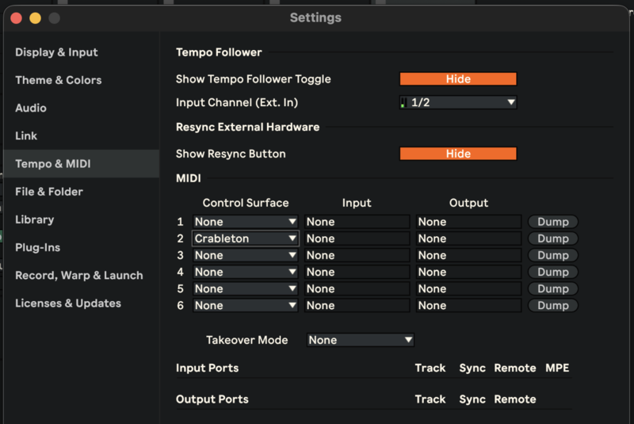

# crableton

An MCP server for Ableton Live, written in Rust. Lets an LLM read and edit a
running Live set: tracks, clips, MIDI notes, devices, arrangement, automation.
98 tools.

Live only loads Python control surfaces, so there are two halves:

- `crableton`, the MCP server.
- `Crableton`, a Python Remote Script that runs inside Live and exposes its
  object model over a local socket. It is bundled into the binary and written
  out by `crableton install`.

## Install

```sh
cargo install --path .
crableton install
```

Restart Live, open Settings > Tempo & MIDI, and pick `Crableton` in any free
Control Surface slot. Leave its Input and Output at `None`: the script talks
to the MCP server over a local socket, not MIDI.



Check it worked:

```sh
crableton doctor
```

Register with an MCP client by running `crableton serve` over stdio.

## Tools

`crableton tools` lists them; `crableton tools --schema` prints full JSON
schemas. By group:

| Group | Covers |
| --- | --- |
| `song` | Tempo, transport, time signature, loop, scale, view, undo |
| `scene` | Create, delete, duplicate, fire, per-scene tempo |
| `track` | Create, delete, mixer and sends (raw or in dB), routing, monitoring |
| `clip` | Create, delete, duplicate, launch settings, warp, envelopes |
| `note` | Read, add, replace, clear, transpose, duplicate, edit or delete by note id, with per-note probability |
| `device` | Parameters by raw or displayed value, rack chains, macros, drum pads |
| `browser` | Search by name, walk the tree, load devices and kits |
| `arrangement` | Create and place clips, delete clips, take lanes, recording, locators |
| `analysis` | Harmony, arrangement structure, mix registers, sample pitch, meters |
| `meta` | Handshake, batch, Live API reference, device reference |

Things worth knowing about:

**`batch`** runs a sequence of tools in one pass on Live's main thread. Faster
than issuing them separately, and the user sees one change rather than the set
assembling itself step by step.

**Track name guard.** Tracks are addressed by index, so a track the user
inserts mid-task shifts every index after it. Every tool that takes
`track_index` also takes `expect_track_name`, the name read with that index.
If the track there is now called something else, the call fails before
writing and says where the name went. Return tracks match with or without
Live's letter prefix. `duplicate_clip` has `expect_target_track_name` for its
destination. A Remote Script older than 2.3.0 cannot check the guard, so
crableton refuses guarded calls to it rather than send them unchecked.

**Automation.** `set_clip_envelope` writes clip automation from breakpoints,
targeting a device parameter or the track mixer. Two Live constraints it
reports rather than hides: automation belongs to a clip, not a track, and Live
will only create an envelope on a Session clip. The working order is to write
the envelope on the Session clip, then `duplicate_clip_to_arrangement`. Live carries
the automation into the Arrangement: as a clip envelope on the copy, or, on a
track that holds devices, as track automation on the Arrangement lane (Live
12.4.6). The copy's result reports each envelope as `carried` with `via` set to
`clip` or `track_lane`. Track-lane automation cannot be read or edited through
the API; to change it, rewrite the Session clip envelope and copy again.
Parameters of devices nested inside racks are not scanned for envelopes.
`get_device_parameters` reports each parameter's `automation_state`.

**Locators.** Live can only toggle a locator at the playhead, and a stopped
playhead can snap to the Arrangement grid (Live 12.4.6 put beat 140 on 128).
The locator tools therefore toggle only once the playhead reads the exact
beat, check afterwards that exactly the intended locator appeared or vanished,
and delete any stray one again. When the beat cannot be reached they change
nothing and name the beat the playhead reached; switching off Snap to Grid
(Cmd-4) usually helps. A playing transport pauses for the few ticks this takes.

**Analysis.** `analyze_harmony`, `analyze_arrangement` and `analyze_mix`
compute from one session snapshot, server-side, so the large payload does not
reach the model. They report measurements, not opinions:

- The tonic, the mode and the scale collection: Dorian is named Dorian rather
  than fitted to the nearest minor key. Plus chord per bar, genuinely chromatic
  notes, and a flag for whether the notes played actually pin the mode down.
- Sections inferred from which tracks are actually playing, with the bar where
  each transition happens and what enters or exits.
- Pitch range and duration-weighted centre per track, pairs of tracks competing
  for the same register, fader positions in decibels.

**Setting by displayed value.** Raw parameter values are often non-linear, so
`set_device_parameter` and `set_device_parameters` also take `display`:
`"220 Hz"`, `"1.5 kHz"`, `"-18 dB"`, `"3 ms"`, `"2.5 s"`, `"90 %"`, `"2:1"`, or
a quantized parameter's setting name. The Remote Script searches for it with
Live's own formatter (`str_for_value`) in one round trip: bisection when the
display is monotonic across the range, a scan otherwise. The reply gives the
display Live settled on and the error. `set_track_mixer` takes `volume_db` and
`set_track_send` takes `value_db` the same way.

**Measuring audio.** Three tools measure sound rather than notes:

- `analyze_sample` reads a Simpler's sample file (or any WAV or AIFF path)
  server-side and reports the fundamental in four windows from attack to body
  (YIN autocorrelation, robust to noisy hits), as Hz, note and cents, plus
  length, peak and RMS. It gives the Simpler Transpose and Detune that put the
  body on the nearest root or fifth of the set's key. WAV and AIFF are parsed
  by hand: a crate like `hound` reads WAV only, and AIFF would need hand-rolling
  anyway.
- `get_meters` samples every track's output meter for a few seconds and
  returns average and peak per track. `probe_entry` plays across a beat and
  flags the tracks that enter there. Both sample inside the Remote Script, one
  pass over every meter per Live tick (about 100 ms), spread across ticks so
  Live is never blocked. Levels are Live's 0 to 1 meter scale, not dBFS, and the
  meters hold peaks, so averages read high.

`lom_reference` and `device_reference` are bundled data, served without
touching Live. The first describes Live's object model; the second covers which
parameters matter on Live's stock devices and what they do.
`describe_live_object` interrogates the running instance when the two disagree.

## Configuration

| Variable | Default | Meaning |
| --- | --- | --- |
| `ABLETON_HOST` | `127.0.0.1` | Where the Remote Script listens |
| `ABLETON_PORT` | `9878` | Port the Remote Script listens on |
| `CRABLETON_POOL_SIZE` | `4` | Concurrent sockets, 1 to 16 |
| `CRABLETON_TIMEOUT_MS` | `15000` | Default per-command budget |
| `CRABLETON_BROWSER_CACHE_SECS` | `120` | Browser cache lifetime |
| `CRABLETON_TOOLSETS` | all | Comma-separated groups to expose |
| `RUST_LOG` | `crableton=info` | Logging, on stderr |

`CRABLETON_TOOLSETS` trims the tool list when 98 definitions is more context
than a task needs, for example `CRABLETON_TOOLSETS=song,clip,note` for MIDI
work. The `meta` group is always included.

## Performance

Connections are pooled, four by default, and the Remote Script serves each on
its own thread, so a slow read does not block everything queued behind it.
Browser listings are cached, since they are the slowest calls in the protocol
and only change when packs are installed. A pooled socket that died because
Live restarted is replaced without the caller seeing it.

`batch` collapses a sequence of edits into a single pass on Live's main thread,
which is where the largest saving is for multi-step work.

## Claude Code plugin

This repo is also a plugin. It registers the MCP server, adds a skill covering
the conventions that are easy to get wrong (times are in beats not bars, note
writes are additive, how automation actually works), and provides
`/live-status` and `/live-reset-arrangement`.

## Development

```sh
cargo test
python3 remote_script/test_remote_script.py
cargo clippy --all-targets
```

The two halves are one protocol with nothing at compile time tying them
together, so `tests/remote_script.rs` parses the Python and checks that every
tool's command has a handler, every handler is implemented and reachable, and
the versions match. `tests/protocol.rs` runs the client against a stand-in
Remote Script, covering both framings, pooling, reconnection and timeouts.

Adding a tool means a row in `src/tools/*.rs` and a handler in the Remote
Script. The cross-check tests fail if you add only one.

## Status and limitations

Tested against Live 12.4.5. Most tools work on Live 11; a few are version-gated
and say so when unavailable (`create_audio_clip` needs 12.0.5 or newer;
per-note probability, `modify_notes` and `remove_notes_by_id` need Live 11 or
newer).

Known gaps:

- Writing an envelope to an already-placed Arrangement clip is implemented but
  not yet verified against Live.
- Live has no API to move an Arrangement clip. Deleting and re-placing it is
  the only route.
- Automation cannot be created on an Arrangement clip at all, only carried
  there from a Session clip. On a track with devices it lands on the track's
  Arrangement automation lane, which the API cannot read or edit.
- `analyze_mix` register ranges are MIDI note fundamentals, not measured
  spectra. Saturation and unison move where a part actually sits, so treat
  reported collisions as places to listen rather than faults.
- `analyze_harmony` finds the tonic by profile correlation and the mode from
  the played pitch classes. The mode is therefore only as good as the tonic:
  material that never emphasises its tonic will be named as a rotation of the
  right collection around the wrong note. Diatonic, pentatonic, blues,
  harmonic minor, melodic minor and whole tone collections are recognised;
  anything else falls back to reporting the chromatic notes.

## Licence

MIT.
